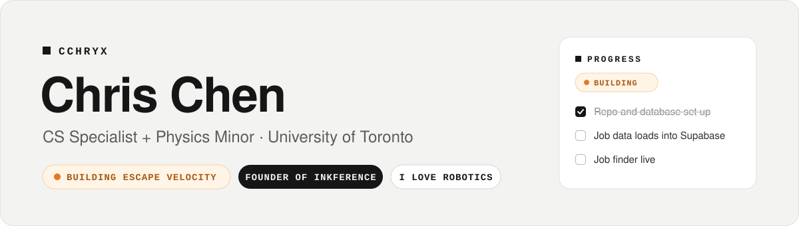

<a href="https://inkference.app/profile/cchryx">
  <picture>
    <source media="(prefers-color-scheme: dark)" srcset="assets/header-dark.svg" />
    
  </picture>
</a>

  
  
  

<table>
  <tr>
    <td width="76" align="center"></td>
    <td><b>Founder of <a href="https://inkference.app">Inkference</a></b>: a portfolio and social app for builders. Show your work, chat live, plan your week and join communities, all in one place.</td>
  </tr>
</table>

### Building now

<!-- INKFERENCE:BUILDING:START -->
-  **[RSX Mars Rover 2026-2027](https://inkference.app/profile/cchryx)** (contributor): Building a Mars rover with UofT's Robotics for Space Exploration team to compete in…
-  **[Escape Velocity](https://inkference.app/project/b7b0d6e4-ad5d-4b96-8c60-00e686021693)**: Find the internships that fit you. Get the courses that launch you there.
-  **[Nozzle Nook](https://inkference.app/project/f2adffff-6582-4187-b7e5-a50c01457494)**: Everyday 3D printed gadgets and organizers I design, print and sell at my booth.
-  **[LastPick.gg](https://inkference.app/profile/cchryx)**: An algorithmic draft engine predicting League of Legends match outcomes and exposing…
<!-- INKFERENCE:BUILDING:END -->

<!-- INKFERENCE:SKILLS:START -->

<!-- INKFERENCE:SKILLS:END -->

