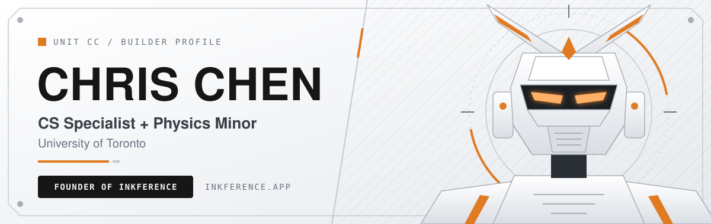

<a href="https://inkference.app/profile/cchryx">
  <picture>
    <source media="(prefers-color-scheme: dark)" srcset="assets/header-dark.svg" />
    
  </picture>
</a>

  
  
  

<picture>
  <source media="(prefers-color-scheme: dark)" srcset="assets/divider-dark.svg" />
  
</picture>

<table>
  <tr>
    <td width="76" align="center"></td>
    <td>
      <b>Founder of <a href="https://inkference.app">Inkference</a></b> 
      The place where builders show their work, talk, plan and ship. Web and mobile.
    </td>
  </tr>
</table>

### What Inkference does

<table>
  <tr>
    <td width="33%" valign="top">
      <b>Show</b> 
      Build a portfolio. Add projects, skills and updates. Share one profile link.
    </td>
    <td width="33%" valign="top">
      <b>Connect</b> 
      Follow builders. Join communities. Chat live.
    </td>
    <td width="33%" valign="top">
      <b>Plan</b> 
      Plan your week. Assign tasks. Keep your team on one board.
    </td>
  </tr>
  <tr>
    <td width="33%" valign="top">
      <b>Create with AI</b> 
      Ask Claude inside your workspace. Make blueprints and files. Ask follow-up questions.
    </td>
    <td width="33%" valign="top">
      <b>Use tools</b> 
      Make a tool, such as a calendar. Get it approved. Attach it to posts or use it on your desk.
    </td>
    <td width="33%" valign="top">
      <b>Take it anywhere</b> 
      Use it on the web. Native mobile apps are live or on the way.
    </td>
  </tr>
</table>

  

<picture>
  <source media="(prefers-color-scheme: dark)" srcset="assets/divider-dark.svg" />
  
</picture>

### Building now

<!-- INKFERENCE:BUILDING:START -->
-  **[RSX Mars Rover 2026-2027](https://inkference.app/project/53ae031c-ca62-404e-9aa4-e70ffa1806dd)** (contributor): Building a Mars rover with UofT's Robotics for Space Exploration team to compete in…
<!-- INKFERENCE:BUILDING:END -->

### Stack

<!-- INKFERENCE:SKILLS:START -->

<!-- INKFERENCE:SKILLS:END -->

<picture>
  <source media="(prefers-color-scheme: dark)" srcset="assets/divider-dark.svg" />
  
</picture>

  Updated automatically from my <a href="https://inkference.app/profile/cchryx">Inkference profile</a>.

